en el video aprendi a como usar git y github desde cero como hacer para indicar que un proyecto sera manejado con git
tambien muchos comandos que ayudan a ver que pasa con tu consola su status y ver si se agrego algo
como añadir cambios a tu repostorio al stage para posteriormente confirmar estos cambios con el commit 
y llevar como pasos para poder marcar hitos o cambios y para despues poder regresar a ellos
agregar mensajes descriptivos a estos commits nos ayudan a llevar un mejor control 
podemos añadir cosas de forma mas especifica poniendo nombre de archivos o poniendo rutas o extensiones
de la misma manera eliminar archivos el dar alias a los comandos hace que comandos que son muy utilizados
usarlos de manera mas rapida el saber como poder modificar nombres y otras cosas nos ayudan a llevar un control mas completo
y tambien hay cosas que podemos hacer que git no controle el dividir un proyecto en diferentes ramas puede resultar util para 
llevar el proyecto en partes para despues unirlas y resolver los errores tambien podemos indicar tags para darles una version
y finalmente aprendi como pasar un repositorio a git hub podemos manejar el repositorio desde cmd y luego pasarlo a git hub 
y vicecersa y tambien como manejarlo desde un editor de texto

- **git init:** crea un repositorio de Git en la carpeta donde estoy. Genera la carpeta oculta `.git`, donde se guarda todo el historial. Se usa una sola vez por proyecto.
- **git status:** muestra el estado de los archivos: en qué rama estoy, qué archivos cambiaron (en rojo) y cuáles ya están listos para el commit (en verde).
- **git add:** pasa los cambios a la zona de staging, es decir, los prepara para el siguiente commit.

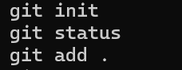

###git commit
Guarda en el historial los cambios que preparé con `git add`. Con `-m` le pongo un mensaje que describe qué se hizo. Por ejemplo, `git commit -m "commit inicial"` crea el primer commit del proyecto.

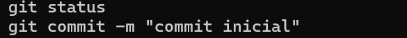

- **git diff:** muestra qué cambió en mis archivos desde el último commit, línea por línea. Las líneas con `+` en verde son las que agregué y las que tienen `-` en rojo son las que eliminé. Solo muestra los cambios que todavía no pasé a staging con `git add`.
- **git checkout archivo:** descarta los cambios que hice en un archivo y lo regresa a como estaba en el último commit. Por ejemplo, `git checkout index.html` restaura `index.html`. Los cambios que no estaban en un commit se pierden.

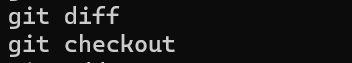

- **git log:** muestra el historial de commits del proyecto, del más reciente al más antiguo. De cada commit enseña su identificador (hash), el autor, la fecha y el mensaje que le puse. Con `git log --oneline` se ve una versión resumida, de una línea por commit.

- **git add index.html:** pasa solo el archivo `index.html` a la zona de staging, es decir, lo prepara para el siguiente commit. A diferencia de `git add .`, que agrega todos los cambios de la carpeta, este comando agrega únicamente el archivo que indico. Después de usarlo, `git status` muestra `index.html` en verde (`Changes to be committed`).

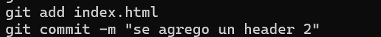

- **git add js/:** pasa a la zona de staging todos los cambios que están dentro de la carpeta `js`, es decir, los prepara para el siguiente commit. Sirve para agregar una carpeta completa sin tener que escribir archivo por archivo, y no afecta lo que esté fuera de ella.

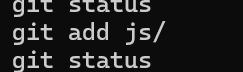

- **git reset css/*.scss:** saca de la zona de staging los archivos con extensión `.scss` que están dentro de la carpeta `css`. Es lo contrario de `git add`: los archivos dejan de estar preparados para el siguiente commit, pero **sus cambios no se pierden**, siguen en mi carpeta como modificados. El asterisco `*` es un comodín que significa "cualquier nombre".

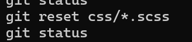

- **git reset *.scss:** saca de la zona de staging todos los archivos con extensión `.scss`. Es lo contrario de `git add`: los archivos dejan de estar preparados para el siguiente commit, pero **sus cambios no se pierden**, siguen en mi carpeta como modificados. El asterisco `*` es un comodín que significa "cualquier nombre", así que lo hace con todos los `.scss` de un solo comando.

- **git add --all:** pasa a la zona de staging todos los cambios de todo el repositorio, es decir, los prepara para el siguiente commit. Incluye los archivos nuevos, los modificados y los eliminados. Es la forma larga de `git add -A` y hace exactamente lo mismo.

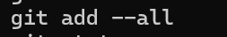

- **git config --global alias.l "log":** crea un alias, es decir, un atajo para un comando de Git. En este caso, `git l` hace lo mismo que `git log`, así escribo menos. Con `--global` el alias queda guardado para todos mis repositorios y no solo para el actual. El nombre del atajo va después de `alias.` y el comando que reemplaza va entre comillas.

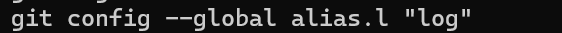

- **git commit --amend:** modifica el último commit en lugar de crear uno nuevo. Sirve para corregir el mensaje del commit o para agregarle un archivo que se me olvidó. Con `git commit --amend -m "mensaje nuevo"` cambio el mensaje. Si antes hago `git add` de otro archivo y luego uso `--amend`, ese archivo se suma al último commit. Solo conviene usarlo en commits que todavía no subí a GitHub, porque cambia el identificador (hash) del commit.

- **git mv:** cambia el nombre de un archivo o lo mueve a otra carpeta, y además deja el cambio listo en la zona de staging. Por ejemplo, `git mv principal.html primal.html` renombra `principal.html` a `primal.html`. Es lo mismo que cambiar el nombre a mano y luego usar `git add` y `git rm`, pero en un solo comando. Después solo falta hacer el commit.

- **git rm:** elimina un archivo de mi carpeta y deja ese borrado listo en la zona de staging, para incluirlo en el siguiente commit. Por ejemplo, `git rm primal.html` borra `primal.html`. Es lo mismo que borrar el archivo a mano y luego usar `git add`, pero en un solo comando. Después solo falta hacer el commit. Si me arrepiento, puedo recuperar el archivo con `git reset` y `git restore`, o regresando al commit anterior.

- **git reset --soft id_del_commit:** regresa la rama al commit que indico con su identificador (hash), y los commits que estaban después desaparecen del historial (`git log`). Con `--soft` **no se pierden los cambios**: los archivos de mi carpeta quedan igual y los cambios de esos commits se quedan en la zona de staging, listos para volver a hacer commit. Por ejemplo, después de borrar un archivo con `git rm` y hacer commit, puedo deshacer ese commit con `git reset --soft` y el id del commit anterior.

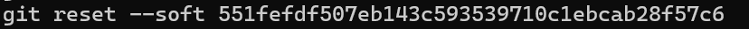

- **git reset --hard id_del_commit:** regresa la rama al commit que indico con su identificador (hash), y los commits que estaban después desaparecen del historial (`git log`). A diferencia de `--soft`, con `--hard` **sí se pierden los cambios**: los archivos de mi carpeta también regresan a como estaban en ese commit y lo que no estaba guardado se borra. Por eso hay que usarlo con cuidado.

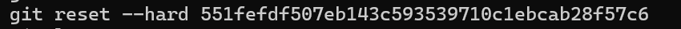

- **git reflog:** muestra el historial de todos los movimientos que hice en el repositorio: commits, resets, checkouts, merges, etc., del más reciente al más antiguo. A diferencia de `git log`, también muestra commits que ya no aparecen en el historial, por ejemplo los que quité con `git reset`. Sirve para recuperar un commit "perdido": busco su identificador (hash) en el reflog y regreso a él con `git reset --hard id_del_commit`.

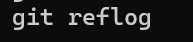

- **git reset --mixed id_del_commit:** regresa la rama al commit que indico con su identificador (hash), y los commits que estaban después desaparecen del historial (`git log`). Con `--mixed` **no se pierden los cambios en mis archivos**, pero sí salen de la zona de staging: quedan como modificados, y tengo que volver a usar `git add` antes de hacer commit. Es el modo por defecto de `git reset`, así que si no escribo `--soft` ni `--hard`, usa este.

- **git branch:** sirve para manejar las ramas del proyecto. Una rama es una línea de trabajo independiente, donde puedo hacer cambios sin afectar la rama principal. Usado solo, `git branch` muestra la lista de ramas y marca con un `*` la rama en la que estoy. Con `git branch nombre` creo una rama nueva y con `git branch -d nombre` la elimino. Para moverme a otra rama uso `git checkout nombre`.

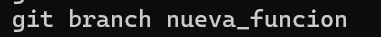

- **git log --oneline --decorate --all --graph:** muestra el historial de commits en forma de gráfica, con una línea por commit. Cada opción hace una cosa:
  - `--oneline`: muestra cada commit en una sola línea (hash corto y mensaje).
  - `--decorate`: indica los nombres de las ramas y de los tags junto al commit donde están, por ejemplo `(HEAD -> main)`.
  - `--all`: muestra todas las ramas, no solo en la que estoy.
  - `--graph`: dibuja con líneas cómo se separan y se unen las ramas.

  Sirve para ver de un vistazo cómo se ramificó el proyecto y dónde se hicieron los merges.

- **git checkout nombre_rama:** me cambia a otra rama del proyecto. Por ejemplo, `git checkout main` me regresa a la rama `main`. Al cambiar de rama, los archivos de mi carpeta se actualizan para mostrar lo que hay en esa rama. Con `git checkout -b nueva_rama` creo una rama nueva y me cambio a ella al mismo tiempo.

- **git merge nombre_rama:** une los cambios de otra rama con la rama en la que estoy. Por ejemplo, estando en `main`, `git merge nueva_rama` trae a `main` todo lo que hice en `nueva_rama`. Si los cambios están en partes distintas de los archivos, Git los mezcla solo y crea un commit de unión (merge). Si las dos ramas modificaron la misma línea, aparece un conflicto (`CONFLICT`) y tengo que elegir a mano qué versión dejar, guardar el archivo y hacer `git add` y `git commit` para terminar el merge.

- **git branch -d nombre_rama:** elimina una rama del proyecto. Por ejemplo, `git branch -d nueva_rama` borra `nueva_rama`. Solo la borra si sus cambios ya se unieron a otra rama con `git merge`; si no, Git avisa para no perder trabajo. No puedo borrar la rama en la que estoy parado, así que primero me cambio a otra con `git checkout main`. Con `-D` en mayúscula la borra aunque no esté unida, así que hay que usarlo con cuidado.

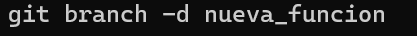

- **git checkout -b nombre_rama:** crea una rama nueva y me cambia a ella al mismo tiempo. Por ejemplo, `git checkout -b nueva_rama` crea `nueva_rama` a partir de la rama en la que estoy y me deja parado en ella. Es lo mismo que usar `git branch nueva_rama` y luego `git checkout nueva_rama`, pero en un solo comando. Los commits que haga después se guardan en la rama nueva y no afectan a `main`.

- **git tag:** le pone una etiqueta (tag) a un commit, normalmente para marcar una versión del proyecto, por ejemplo `v1.0`. Con `git tag v1.0` creo la etiqueta en el commit donde estoy, y usado solo, `git tag`, muestra la lista de etiquetas que existen. Un tag funciona como un marcador que no se mueve, así que luego puedo volver fácil a esa versión.

- **git tag -d nombre_tag:** elimina una etiqueta. Por ejemplo, `git tag -d v1.0` borra la etiqueta `v1.0`. Solo borra la etiqueta, el commit y sus cambios se quedan igual.

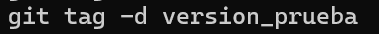

- **git tag -a nombre_tag -m "mensaje":** crea una etiqueta anotada, es decir, una etiqueta que además guarda un mensaje, el autor y la fecha. Por ejemplo, `git tag -a v1.0 -m "primera versión"` crea la etiqueta `v1.0` con ese mensaje. La `-a` significa "annotated" (anotada) y `-m` sirve para escribir el mensaje, igual que en `git commit`. Es más completa que un `git tag` normal, porque después puedo ver esa información con `git show v1.0`.

- **git show nombre_tag:** muestra la información de una etiqueta y del commit al que apunta. Por ejemplo, `git show v1.0` muestra quién creó la etiqueta, la fecha, su mensaje (si es una etiqueta anotada), y los cambios que se hicieron en ese commit. Sirve para revisar qué versión es esa y qué contiene, sin tener que cambiarme de commit.

- **git tag -a nombre_tag id_del_commit -m "mensaje":** crea una etiqueta anotada en un commit en particular, no en el último. Por ejemplo, `git tag -a v0.9 fe5cc8e -m "versión inicial"` le pone la etiqueta `v0.9` al commit con ese identificador (hash). Sirve para marcar una versión después de haber hecho más commits, ya que sin el id, la etiqueta se crea en el commit donde estoy parado. Igual que antes, `-a` la hace anotada y `-m` guarda el mensaje.

- **git remote add origin https://github.com/fabiobaezzzz/demo_2.git:** conecta mi repositorio local con el repositorio que creé en GitHub. `remote add` agrega una conexión remota, `origin` es el nombre que le doy a esa conexión (es el nombre que se usa por costumbre) y el link es la dirección del repositorio en GitHub.
- **git push -u origin main:** sube mi rama `main` a GitHub, al repositorio `origin`. Con `-u` Git deja vinculada mi rama local con la de GitHub, así que después solo necesito escribir `git push` para subir mis cambios.

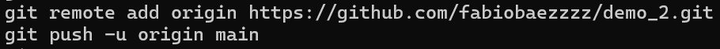

- **git clone link_del_repositorio:** descarga a mi computadora una copia completa de un repositorio que está en GitHub, con todos sus archivos y su historial de commits. Por ejemplo, `git clone https://github.com/fabiobaezzzz/demo_2.git` crea una carpeta `demo_2` con todo el proyecto. El link lo copio del botón verde **Code** del repositorio. Sirve para empezar a trabajar en otra computadora, y la copia ya queda conectada a GitHub como `origin`, así que no necesito usar `git remote add`.

- **git pull:** trae los cambios que hay en GitHub y los une con mi rama local. Es útil cuando el repositorio tiene commits que mi computadora todavía no tiene, por ejemplo si edité un archivo directamente en la página de GitHub o si trabajé desde otra computadora. En mi caso lo usé después de crear el README en GitHub, porque `git push` me marcó el error `rejected (fetch first)`. Con `git pull` Git descargó el cambio, lo mezcló con mi trabajo y ya pude subir mis commits con `git push`.

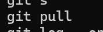

creo que las dificultades no son muchas ya que si sigues el paso a paso no es algo tan complejo un problema que veo a futuro seria el que al hacerlo sin un guia se vuelve mas dificil pero creo que con practica vas a ir entendiendo poco a poco las sintaxis y en que casos debes usar cada comando 